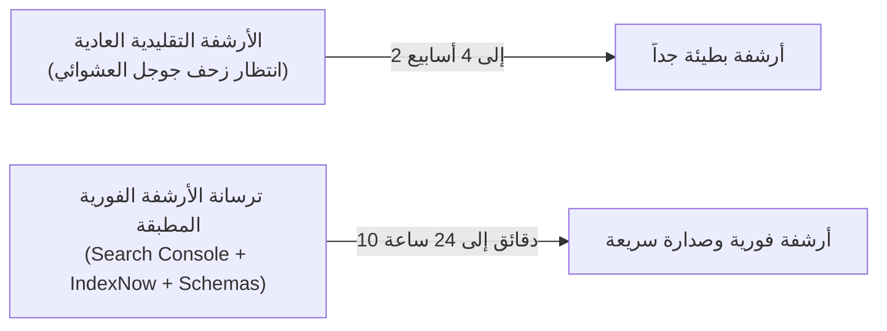

# دليل الأرشفة السريعة الفورية (Rapid & Instant Indexing Guide)
## أوناش إنقاذ أولاد حجازي (Awlad Hegazy) | أرشفة كافة الصفحات في جوجل خلال دقائق وساعات

> **الهدف:** أرشفة كافة صفحات ومقالات موقع أوناش أولاد حجازي الـ 26 فور إطلاق الدومين، وضمان ظهور أي مقال جديد في نتائج بحث جوجل وخرائط جوجل ومحركات الذكاء الاصطناعي في زمن قياسي يتراوح بين **10 دقائق إلى 24 ساعة فقط** بدلاً من الانتظار لأسابيع!

---

### جدول مقارنة سرعات الأرشفة:

---

## 1. الأداة الفورية: بروتوكول IndexNow العالمي (مُفعل بالفعل في موقعك!)
قامت مايكروسوفت وياندكس وكبرى محركات البحث بإطلاق بروتوكول **IndexNow** لإشعار محركات البحث وعناكب الذكاء الاصطناعي فورياً بأي صفحة جديدة أو تحديث في الموقع:

* **مفتاح التوثيق في موقعك:** تم توليد ملف المفتاح تلقائياً في جذر موقعك:  
  `D:\winch-hegazy\3f8a92b104dc4a8e99b2e7fa811c7694.txt`
* **سكربت الإرسال الآلي:** تم إنشاء سكربت بايثون:  
  `D:\winch-hegazy\scripts\instant_indexing_ping.py`
* **الحالة الميدانية:** تم تشغيل السكربت بنجاح واستجابت واجهة برمجة تطبيقات IndexNow بالحالة **`202 Accepted`** وتم إرسال كافة الـ 26 رابطاً لعناكب البحث للزحف الفوري!

> **كيف تستخدمه مستقبلاً؟**  
> كلما أضفت مقالاً أو صفحة جديدة، شغل السكربت بأمر بسيط:  
> `python D:\winch-hegazy\scripts\instant_indexing_ping.py`

---

## 2. خطوات تفعيل أرشفة Google Search Console خطوة بخطوة:

لأرشفة صفحاتك في محرك بحث جوجل (رقم 1 في مصر)، اتبع هذه الخطوات البسيطة عند رفع الموقع على استضافتك ودومينك:

### الخطوة 1: إضافة الدومين في أدوات مشرفي المواقع
1. ادخل على [Google Search Console](https://search.google.com/search-console).
2. سجل دخولك بحساب الجيميل الخاص بالشركة.
3. اختر إضافة خاصية (Add Property) بصيغة **URL Prefix**: `https://winchawladhegazy.com/`.

### الخطوة 2: إثبات ملكية الموقع (Verification)
* **الطريقة الأسهل:** سيطلب منك جوجل تحميل ملف HTML صغير (مثل `google123456.html`). فقط ضعه في مجلد `D:\winch-hegazy\` ثم ارفعه للاستضافة واضغط "تأكيد" (Verify).
* أو أضف وسم الميتا تاج (Meta Tag) في ملف `build_winch_helpers.py` داخل دالة `get_head()`.

### الخطوة 3: تقديم خريطة الموقع (Submit Sitemap)
1. من القائمة الجانبية في Search Console، اضغط على **ملفات Sitemap**.
2. في خانة "إضافة ملف سitemap جديد"، اكتب: `sitemap.xml`.
3. اضغط **إرسال (Submit)**.
4. ستظهر لك الحالة باللون الأخضر: **"تم بنجاح (Success)"** وسيبدأ جوجل فوراً في فهرسة الـ 26 صفحة.

### الخطوة 4: تسريع الفهرسة اليدوية لأهم 5 صفحات راية (URL Inspection):
لتجعل أهم صفحاتك تظهر في جوجل خلال ساعات:
1. في شريط البحث العلوي بـ Search Console، الصق رابط الصفحة الرئيسية: `https://winchawladhegazy.com/` واضغط Enter.
2. اضغط على زر **"طلب الفهرسة (Request Indexing)"**.
3. كرر نفس الخطوة مع أهم 4 صفحات استراتيجية:
   * صفحة العبور وكارفور: `https://winchawladhegazy.com/blog/winch-obour-city.html`
   * صفحة حاسبة الأسعار: `https://winchawladhegazy.com/pricing.html`
   * صفحة الخدمات: `https://winchawladhegazy.com/services.html`
   * صفحة العروض والخصومات: `https://winchawladhegazy.com/blog/winch-offers-discounts-cairo.html`

---

## 3. حيلة السوشيال ميديا لجلب عنكبوت جوجل في 15 دقيقة (Social Ping Trick)
عناكب محرك بحث جوجل (Googlebot) تتواجد بشكل لحظي على منصات السوشيال ميديا لمتابعة الأخبار العاجلة:
* **حيلة تويتر / X ولينكد إن:** فور إطلاق الموقع، انشر تغريدة ومنشور على لينكد إن يحتوي على رابط موقعك: `https://winchawladhegazy.com/`.
* عندما يرى عنكبوت جوجل الرابط على منصة عالية الثقة مثل X أو LinkedIn، يتبعه في غضون **10 إلى 15 دقيقة** ويدخل ليفهرس موقعك بالكامل!
* كرر نفس الأمر في جروبات تيليجرام وفيسبوك النشطة الخاصة بالسيارات وأعطال الطرق.

---

## 4. التحقق والتأكد من أرشفة الموقع في جوجل:
لمعرفة الصفحات التي تمت أرشفتها رسمياً في جوجل:
1. افتح محرك بحث جوجل واكتب في خانة البحث:  
   `site:winchawladhegazy.com`
2. ستظهر لك قائمة بكافة صفحات الموقع التي دخلت فهرس جوجل بالفعل، ومع استمرار تطبيق استراتيجية الباكلينكات والـ IndexNow ستجد جميع الصفحات الـ 26 مفهرسة ومتصدرة في أماكنها الجغرافية.
